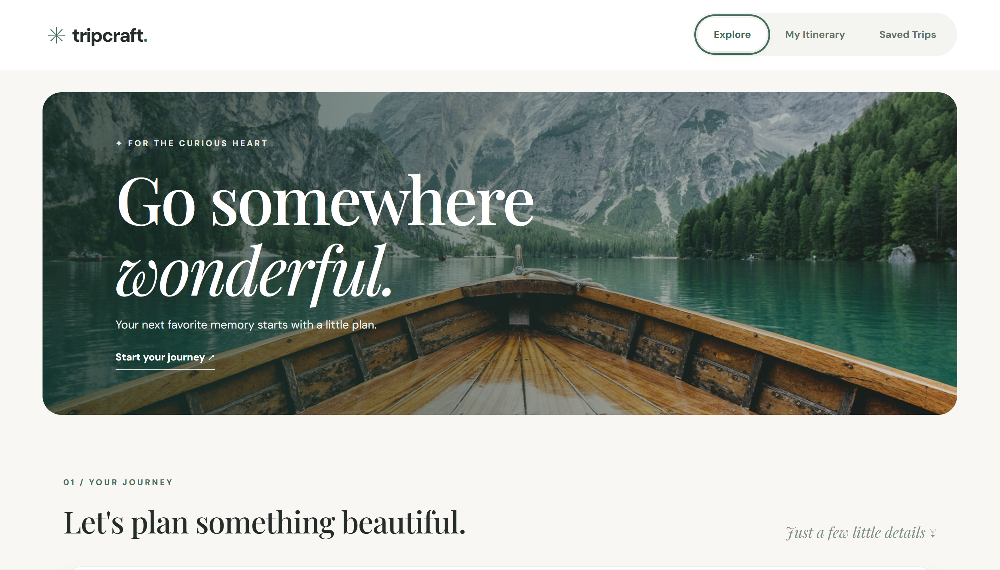
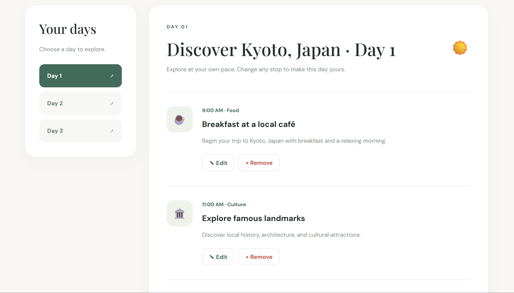
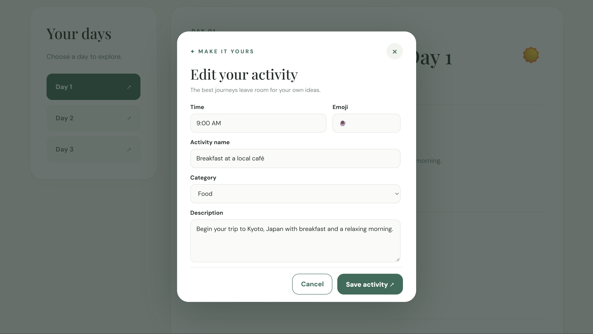
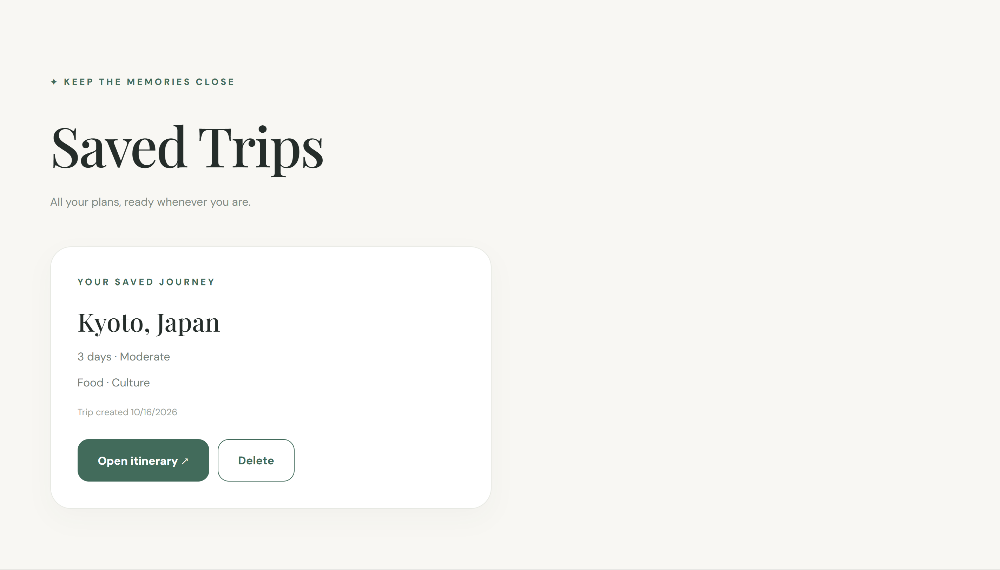

# 🌿 TripCraft AI

### Your next adventure, thoughtfully planned.

TripCraft AI is a full-stack travel itinerary planner that helps users create personalized, day-by-day travel plans based on their destination, trip duration, budget, and interests.

Built with React, Node.js, Express, and Google's Gemini API, TripCraft allows users to generate travel suggestions, customize activities, and save itineraries for future reference.

The application features a responsive, ivory-and-sage interface inspired by travel journals and minimalist design.

**Live Website:** [TripCraft AI](https://tripcraft-ai-o4ad.onrender.com/)

**GitHub Repository:** [thv-cyber/tripcraft-ai](https://github.com/thv-cyber/tripcraft-ai)

---

## Features

### AI-Powered Itinerary Generation

Users can generate a personalized itinerary by selecting:

- **Destination:** Any city or travel destination
- **Trip duration:** 1 to 14 days
- **Travel style:** Budget-friendly, Moderate, or Luxury
- **Interests:** Food, Culture, Nature, Adventure, Shopping, and Relaxation

TripCraft sends the selected details to an Express backend, which communicates with Google's Gemini API to request a structured, day-by-day itinerary.

Each generated itinerary includes:

- Daily activity suggestions
- Approximate activity times
- Activity names and descriptions
- Categories and emojis
- Separate schedules for each travel day

AI-generated recommendations are suggestions and are not verified bookings, prices, or opening hours.

### Editable Activities

Users can customize their itineraries by:

- Adding new activities
- Editing existing activities
- Updating times, names, categories, emojis, and descriptions
- Removing unwanted activities

A custom React modal provides an editing interface that matches the application's design.

### Saved Trips

Users can save itineraries and access them through the Saved Trips page.

Saved data is stored using the browser's `localStorage` API.

This means saved trips persist when the page is refreshed in the same browser, but they are not synchronized across devices or browsers.

### AI Loading Experience

While Gemini processes an itinerary request, TripCraft displays an animated loading panel with rotating messages and itinerary placeholders.

Users can cancel waiting for a request. Cancelling in the browser does not necessarily stop processing on the backend.

### Demo Fallback

If Gemini is temporarily unavailable or a supported rate limit is reached, the backend can return a sample itinerary instead.

Responses contain a `source` field identifying whether the itinerary was generated by AI or created using demo data.

The frontend displays the appropriate label so users can distinguish between AI and demo results.

### Responsive Interface

TripCraft includes responsive layouts for desktop, tablet, and mobile screens, including:

- A trip-planning form
- Featured destination cards
- Day-by-day itinerary navigation
- Activity cards
- A scrollable activity-editing modal
- Saved-trip cards

---


## Screenshots

### Explore Page

Plan a personalized trip by choosing a destination, duration, travel style, and interests.



### Generated Itinerary

Explore a day-by-day travel itinerary with activity recommendations, approximate times, and descriptions.



### Activity Editor

Customize an itinerary by editing activity names, times, categories, emojis, and descriptions.



### Saved Trips

Save itineraries in the browser and reopen them whenever needed.



---

## Tech Stack

| Technology | Purpose |
|------------|---------|
| React | Frontend interface and component state |
| Vite | Frontend development and production builds |
| JavaScript | Application logic |
| HTML & CSS | Structure, styling, and responsive layouts |
| Node.js | Backend JavaScript runtime |
| Express | REST API and production server |
| Google Gemini API | AI itinerary generation |
| Google Gen AI SDK | Communication with Gemini |
| express-rate-limit | Basic API request limiting |
| localStorage | Browser-based trip persistence |
| Git & GitHub | Version control and source code hosting |
| Render | Full-stack web deployment |

---

## How It Works

TripCraft uses a React frontend and an Express backend.

1. The user enters their travel preferences.
2. React sends the details to `POST /api/generate-trip`.
3. Express validates the submitted information.
4. The backend requests a structured itinerary from Gemini.
5. The response is checked and formatted for the frontend.
6. React displays the itinerary with editable activities.
7. The user can save the itinerary in their browser.

If Gemini is temporarily unavailable, the backend can provide a clearly labeled demo itinerary.

### Application Flow

```text
User
  |
  v
React Frontend
  |
  | POST /api/generate-trip
  v
Express Backend
  |
  | Validate trip details
  v
Google Gemini API
  |
  | Structured itinerary response
  v
Express Backend
  |
  | Format activities and add IDs
  v
React Itinerary View
  |
  | Edit / Add / Remove
  v
Browser localStorage
```

The Gemini API key is stored on the server and is not included in the React frontend.

---

## Getting Started

### Prerequisites

Before running TripCraft locally, install:

- Node.js
- npm
- Git
- A code editor such as Visual Studio Code

A Gemini API key is needed for live AI itinerary generation.

Without an API key, the backend can use demo mode.

### 1. Clone the Repository

```bash
git clone https://github.com/thv-cyber/tripcraft-ai.git
cd tripcraft-ai
```

### 2. Install Frontend Dependencies

```bash
npm install
```

### 3. Install Backend Dependencies

```bash
cd server
npm install
```

### 4. Configure Environment Variables

Inside the `server` folder, create a file named `.env`.

Add:

```env
GEMINI_API_KEY=your_gemini_api_key_here
GEMINI_MODEL=your_available_gemini_model
```

Replace the placeholder values with your own configuration.

A Gemini API key can be created through [Google AI Studio](https://aistudio.google.com/app/apikey).

The model must be available to your Gemini API project. Availability, quotas, and pricing depend on the selected model and account.

**Never commit your `.env` file or API key to a public repository.**

### 5. Start the Backend

From the `server` folder:

```bash
node index.js
```

The backend runs locally at:

```text
http://localhost:3001
```

You can check the backend status at:

```text
http://localhost:3001/api/health
```

### 6. Start the Frontend

Open another terminal in the main `tripcraft-ai` folder.

Run:

```bash
npm run dev
```

Open the local Vite URL shown in the terminal, typically:

```text
http://localhost:5173
```

During local development, Vite proxies `/api` requests to the Express backend.

---

## API Endpoints

### GET `/api/health`

Returns the backend status and whether a Gemini API key has been configured.

Example response:

```json
{
  "status": "ok",
  "message": "TripCraft backend is running!",
  "aiConfigured": true
}
```

The `aiConfigured` field indicates that a key was loaded. It does not independently verify the key or its quota.

### POST `/api/generate-trip`

Creates an itinerary using the submitted trip preferences.

Example request:

```json
{
  "destination": "Kyoto, Japan",
  "duration": 3,
  "budget": "Moderate",
  "interests": ["Food", "Culture"]
}
```

Example response structure:

```json
{
  "message": "AI itinerary created successfully!",
  "source": "ai",
  "trip": {
    "destination": "Kyoto, Japan",
    "duration": 3,
    "budget": "Moderate",
    "interests": ["Food", "Culture"],
    "days": [
      {
        "day": 1,
        "title": "Exploring Kyoto",
        "activities": [
          {
            "id": "generated-activity-id",
            "time": "9:00 AM",
            "icon": "🏯",
            "title": "Visit a Historic Temple",
            "description": "Explore a cultural landmark in Kyoto.",
            "category": "Culture"
          }
        ]
      }
    ]
  }
}
```

The sample above illustrates the response structure. Actual AI-generated titles and activities will vary.

A successful demo fallback uses `"source": "demo"` instead of `"source": "ai"`.

---

## Challenges and What I Learned

### 1. Connecting React and Express

One of the main challenges was connecting a React frontend to a separate Express backend.

During development, the frontend and backend ran on different local ports.

I learned how to:

- Create Express API endpoints
- Send requests using the Fetch API
- Validate incoming JSON data
- Handle loading and error states
- Configure a Vite development proxy
- Use relative API URLs for deployment

### 2. Working with the Gemini API

Integrating Gemini introduced challenges involving model availability, structured JSON responses, and temporary service errors.

I encountered API errors related to model access and an incorrectly structured JSON schema.

To address these problems, I adjusted the model configuration, corrected the schema, and added response validation.

I also implemented retries for temporary server errors and a demo fallback to keep the application usable when Gemini cannot generate an itinerary.

This helped me understand how to integrate external APIs more reliably.

### 3. Managing React State

The itinerary needed to support several user actions without losing the rest of the trip information.

I used React state to manage:

- The selected travel preferences
- Generated itineraries
- Active travel days
- Activity editing
- Loading and error messages
- Saved trips

I practiced updating nested objects and arrays without directly mutating React state.

### 4. Designing a Responsive Interface

I wanted TripCraft to feel like a travel-planning application rather than a basic form or generic dashboard.

I created an ivory-and-sage visual style using CSS, typography, cards, and responsive layouts.

I also improved the activity editor after testing revealed that the original popup required too much scrolling.

This reinforced the importance of testing and refining interfaces based on actual usage.

### 5. Deploying a Full-Stack Application

Deploying TripCraft required preparing both React and Express for a production environment.

I learned how to:

- Build a React application for production
- Serve static React files through Express
- Configure environment variables securely
- Connect a GitHub repository to Render
- Use production build and start commands
- Review deployment logs

This was an important step in moving the project beyond local development.

---

## Current Limitations

TripCraft is a portfolio project and is not intended to replace verified travel-planning or booking services.

Current limitations include:

- AI suggestions may contain inaccurate or outdated travel information.
- Opening hours, prices, and bookings are not verified.
- Saved trips use localStorage rather than a database.
- Trips are not synchronized across devices.
- There are no user accounts or authentication.
- Gemini's free-tier access and availability can vary.
- The Render free service may take time to start after inactivity.
- API rate limiting provides basic protection but does not guarantee that public usage will stay within Gemini quotas.

---

## Future Improvements

Possible improvements include:

- User accounts and cloud-based trip storage
- Verified place information through a travel or maps API
- Map integration for itinerary locations
- Drag-and-drop activity reordering
- More detailed budget estimates
- Trip date selection
- PDF itinerary export
- Additional accessibility and usability improvements

These are planned ideas and are not part of the current implementation.

---

## Deployment

TripCraft is deployed as a full-stack Node.js web service on Render.

The production build compiles the React frontend, and Express serves the built files alongside the API endpoints.

**Live Application:**

https://tripcraft-ai-o4ad.onrender.com/

**Source Code:**

https://github.com/thv-cyber/tripcraft-ai

---

## Author

Created by [thv-cyber](https://github.com/thv-cyber).

TripCraft AI was developed as a hands-on full-stack portfolio project to practice frontend development, backend APIs, AI integration, responsive design, debugging, and deployment.

---

## Acknowledgments

- [Google Gemini](https://ai.google.dev/) — AI generation
- [React](https://react.dev/) — Frontend development
- [Vite](https://vite.dev/) — Frontend tooling
- [Express](https://expressjs.com/) — Backend framework
- [Render](https://render.com/) — Hosting
- [Unsplash](https://unsplash.com/) — Destination imagery

---

*Made for the places you haven't seen yet. 🌿*
